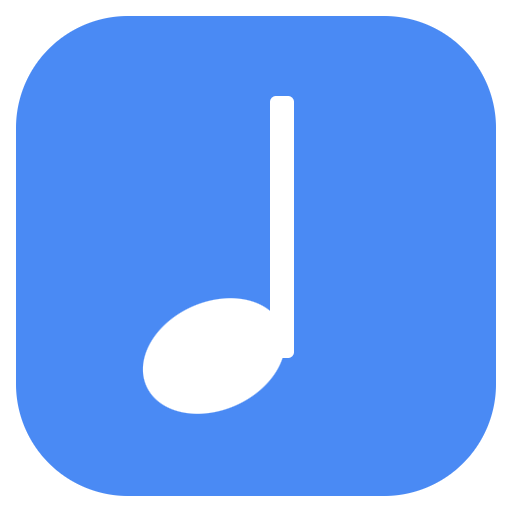
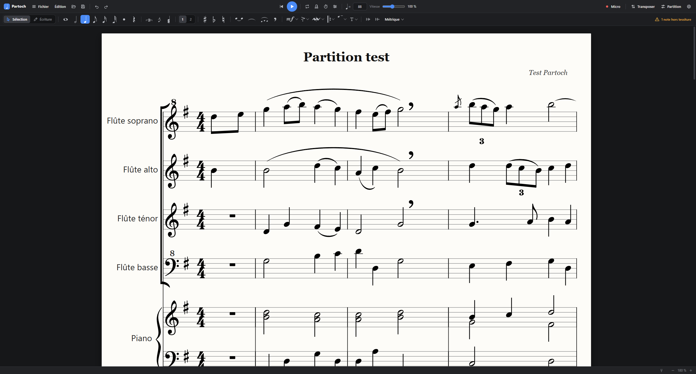

<p align="center">
  
</p>

<h1 align="center">Partoch editor</h1>

<p align="center">
  Éditeur de partitions pour flûte à bec et piano, gratuit, pour Windows.
</p>

<p align="center">
  <a href="https://github.com/Gengisclan/partoch-editor/releases/latest/download/Installer-Partoch-editor.exe"><b>Télécharger l'installateur</b></a>
  &nbsp;·&nbsp;
  <a href="https://github.com/Gengisclan/partoch-editor/releases/latest/download/Partoch-editor-portable.exe">Version portable (clé USB)</a>
</p>



## Fonctions

- **Écriture** : souris ou clavier, accords, triolets, petites notes, deux voix, levée
- **Signes** : nuances, soufflets, articulations, ornements, reprises, D.C. / D.S., tempo
- **Textes** : paroles sur plusieurs couplets, accords, basse chiffrée
- **Lecture** : sons de flûte à bec et de piano, métronome, boucle, vitesse d'entraînement
- **Micro** : transcription de ce qui est joué, accordeur (La 440, 442, 415, 392)
- **Import** : MusicXML, MIDI, enregistrement audio, scan de partition (PDF ou image)
- **Export** : PDF A4, parties séparées, MusicXML, MIDI
- **Instruments** : flûtes soprano, alto, ténor, basse, piano ; transposition, tessitures

## Installer

- **Installateur** : télécharge et installe Partoch, avec un raccourci sur le Bureau.
- **Portable** : rien à installer, tout reste à côté du fichier (partitions et réglages), idéal sur une clé USB.

Windows peut afficher « Windows a protégé votre ordinateur » (application non signée) : *Informations complémentaires* → *Exécuter quand même*.

Mode d'emploi complet : [Readme.txt](Readme.txt)

## Depuis les sources

```
npm install
npm start
npm run dist
```

<sub>Rendu des partitions : [VexFlow](https://github.com/0xfe/vexflow) (MIT). Transcription audio : [Basic Pitch](https://github.com/spotify/basic-pitch) (Apache-2.0). Sons : FluidR3 et MusyngKite ([midi-js-soundfonts](https://github.com/gleitz/midi-js-soundfonts)). Scan : [Audiveris](https://github.com/Audiveris/audiveris) (AGPL, téléchargé à part).</sub>
